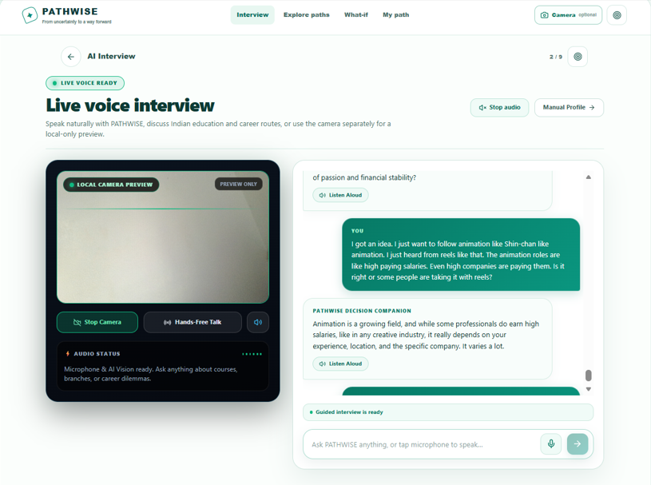
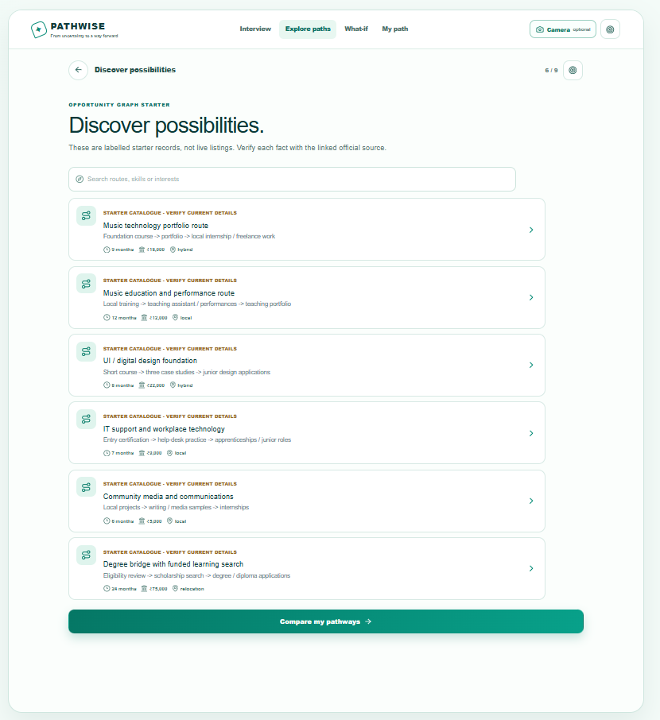
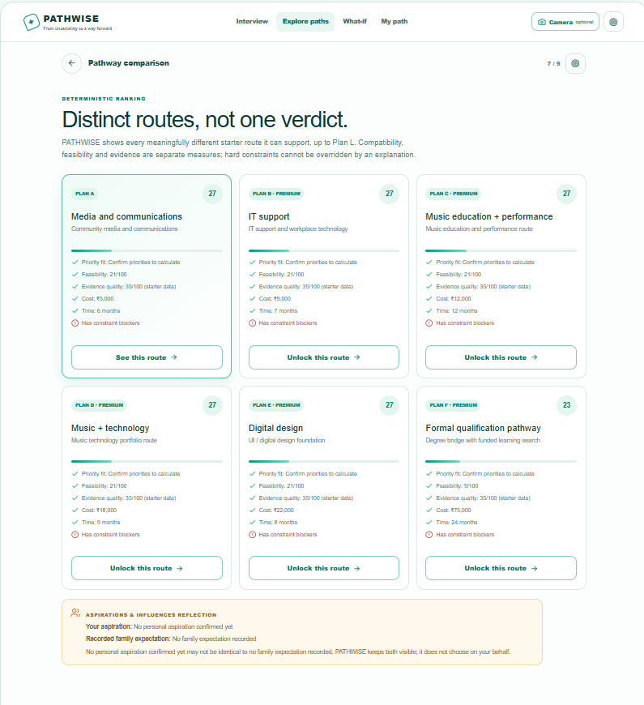
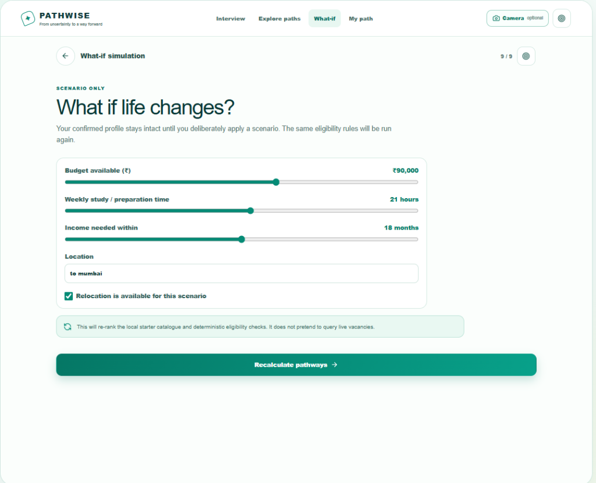
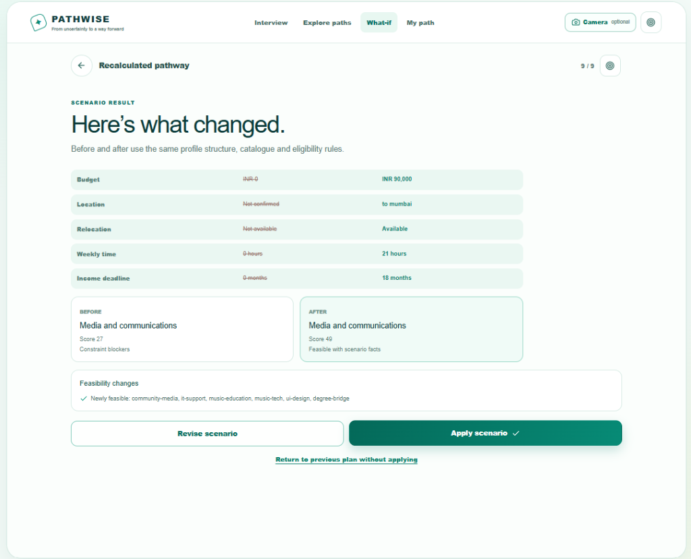

# ✦ PATHWISE
### *From uncertainty to a way forward.*

An AI-powered, personalized career and life decision companion designed to help people navigate crossroads with clarity, agency, and grounded realism.

---

> ### **What if AI could help you choose a life that feels right for YOU — not just one that looks right to society?**
>
> This question is where **PATHWISE** began.
>
> We live in a world where success is often defined for us:
> *A doctor. An engineer. A high-paying corporate job. A prestigious title.*
>
> But what if someone's passion is music? What if someone values peace over money, family over ambition, or personal fulfilment over social recognition?
>
> What if someone wants to pursue their dream but feels trapped between what they want and what everyone expects them to become?
>
> **Not everyone has the same definition of prosperity. So why should everyone follow the same path?**
>
> That was the problem we set out to solve with **PATHWISE** — an AI-powered, personalized career and life decision companion. 💚

---

## 💡 The Vision Behind PATHWISE

Imagine having a conversation with an AI that goes beyond simply asking what job you want.

Through an ongoing, multimodal interaction, **PATHWISE** understands the deep tapestry of factors that influence real-world life choices:
- **Passions & Interests**
- **Financial Constraints & Budgets**
- **Family Expectations & Responsibilities**
- **Social & Peer Pressures**
- **Risk Tolerance & Timelines**
- **Personal Well-Being & Support Needs**

### What PATHWISE Helps You Do:

- 🔹 **Understand your priorities:** Identify the factors that matter most to you, with transparent confidence scores reflecting how accurately the system understands your preferences.
- 🔹 **Explore multiple possibilities:** Generate distinct **Plan A, Plan B, and Plan C** pathways based on different priorities, opportunities, and potential outcomes.
- 🔹 **Prepare for uncertainty:** Simulate "What-If" scenarios to test best-case and worst-case conditions before committing.
- 🔹 **Turn decisions into action:** Build a personalized 30-day strategy with achievable, bite-sized milestones.
- 🔹 **Adapt when life changes:** Revisit priorities, reflect on progress, and recalculate your roadmap dynamically when circumstances change.

> **The bigger vision is not to make decisions for people. It is to help people make decisions with greater clarity, confidence, and ownership of their lives.**
> 
> *Because sometimes, people don't need someone else to tell them what to become. They need the space, guidance, and confidence to figure it out themselves.*

---

## 📸 Product Walkthrough

### 1. Voice-First Multimodal Interview
*Speak naturally, share your thoughts, and explore dilemmas with real-time audio and optional camera preview.*



- **Native Realtime Voice**: Hands-free voice dialogue with live audio streaming and instant transcription.
- **Privacy-by-Design**: Camera and microphone operate strictly under user permission; media remains local to your browser session and is never uploaded or used to infer emotion or capability.
- **Empathetic Companion**: Listens to personal dilemmas (e.g. balancing creative pursuits with financial stability) without judging or rushing to a single answer.

---

### 2. Discover Opportunities & Possibilities
*Browse transparent, verified starter catalogues across diverse creative, technical, and educational domains.*



- Curated starter records covering music technology, digital design, community media, IT support, and degree bridge pathways.
- Explicit indicators for duration, costs, location requirements (local, hybrid, relocation), and official sources.

---

### 3. Distinct Routes, Not One Verdict (Plan A through Plan L)
*Why settle for a single biased chatbot opinion? PATHWISE generates distinct alternative plans scored mathematically.*



- **Deterministic Evaluation**: Each pathway (Plan A, Plan B, Plan C...) is independently evaluated for:
  - **Priority Fit**: How closely the route aligns with your confirmed personal values.
  - **Feasibility Score**: Real-world viability based on your budget, time, and qualifications.
  - **Evidence Quality**: Reliability of source data and official criteria.
- **Aspirations & Influences Reflection**: Visually separates your individual aspirations from family and peer expectations, keeping potential conflicts transparent.

---

### 4. What-If Life Changes Simulation
*Test how your future adapts when your financial, time, or location constraints change.*



- Interactive sliders to experiment with:
  - **Available budget (₹)**
  - **Weekly study / preparation hours**
  - **Income timeline requirements**
  - **Relocation willingness and location limits**
- Safe sandbox testing: profile data remains unchanged until you deliberately apply a scenario.

---

### 5. Adaptive Re-planning & Roadmap Recalculation
*Life rarely follows a straight line. When an obstacle strikes, PATHWISE recalculates without discarding past progress.*



- **Transparent Comparison**: Shows exact "Before" and "After" impacts across budget, relocation, and weekly commitments.
- **Preserved Milestones**: Keeps completed tasks intact while restructuring upcoming steps to overcome new hurdles.

---

## ⚡ Why PATHWISE is Different from ChatGPT

| Dimension | Standard Chatbots (e.g., ChatGPT) | **PATHWISE** |
| :--- | :--- | :--- |
| **Output** | Unstructured walls of text and generic suggestions. | **Structured decision canvas** with distinct Plans A–L, milestones, and actionable tasks. |
| **Constraints** | Suggests ideas regardless of whether you have the time or budget. | **Enforces hard constraints**: validates budget (₹), weekly study hours, timeline to income, and relocation feasibility. |
| **Cultural Reality** | Treats career decisions in isolation. | **Socioculturally grounded**: separates personal desires from family expectations and social prestige pressure. |
| **Scoring** | Subjective, hallucinatory opinions. | **Deterministic scoring engine** calculating feasibility, profile match, and evidence quality. |
| **When Life Changes** | You must re-explain everything in a new chat. | **Dynamic Re-planning Engine**: updates the roadmap while preserving completed milestones. |
| **Interaction** | Text prompts and generic chatbot turns. | **Low-latency live voice interaction** designed for approachable, natural conversation. |

---

## 🛠️ Architecture & Tech Stack

- **Frontend & App Framework**: [Next.js](https://nextjs.org/) (App Router, Turbopack, React 19)
- **Styling**: Vanilla CSS design system with custom micro-animations, glassmorphism, responsive mobile-first layouts
- **Decision Engine**: `src/lib/pathway-engine.ts` — Deterministic ranking algorithms, constraint validators, and replanning logic
- **AI Voice & Multimodal Layer**: Google GenAI Live API with short-lived server-minted session tokens
- **Data Privacy**: Zero server-side retention of raw audio/camera feeds; local storage session persistence

---

## 🚀 Getting Started

### Prerequisites
- Node.js 18+ installed
- (Optional) Google AI Studio Gemini API Key for live voice sessions

### 1. Clone & Install Dependencies
```bash
git clone https://github.com/your-username/pathwise.git
cd pathwise
npm install
```

### 2. Configure Environment Variables
Create a `.env.local` file in the root directory:
```env
# Optional: Add your Gemini API key to enable live voice assistance
GEMINI_API_KEY=your_gemini_api_key_here

# For local testing without full auth constraints:
PATHWISE_ALLOW_UNAUTHENTICATED_LIVE_DEMO=true
```

### 3. Run the Development Server
```bash
npm run dev
```

Open [http://localhost:3000](http://localhost:3000) in your browser to experience PATHWISE.

### 4. Build for Production
```bash
npm run build
npm start
```

---

## 🔒 Privacy & Safety Notice

- **Camera & Mic**: PATHWISE only requests browser camera and microphone permissions when triggered by the user. Media is kept strictly within the local browser context and is never uploaded, recorded, or used for facial diagnosis.
- **API Keys**: Permanent API keys remain strictly on the server. The client browser only receives ephemeral, short-lived tokens.
- **Starter Catalogue**: Opportunity data consists of illustrative starter records intended to demonstrate the decision framework. Always verify details with official educational and institutional sources.

---

<p align="center">
  <b>PATHWISE</b> — Helping you build a life that feels right for <i>you</i>. 💚
</p>
